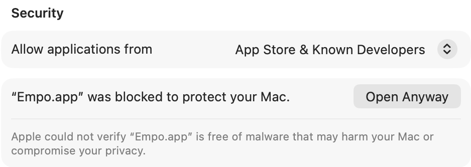

Empo is pre-release, so it is not on the App Store. Each release has an `.ipa` file for iPhone
and iPad, and a disk image for Mac. You install them yourself.

## Requirements

An iPhone or an iPad with iOS 26 or newer and a sideloading tool, or a Mac with Apple silicon and
macOS 26 or newer. You also need a game to play, because Empo ships no games.
[Requirements](/requirements) has the full list.

## iPhone and iPad

<Steps>
  <Step title="Download the IPA">
    Open the [Releases page](https://github.com/mateo-m/empo-app/releases). Download the `.ipa`
    file from the newest release.
  </Step>
  <Step title="Sideload it">
    Install the `.ipa` file with AltStore, SideStore, or Sideloadly. Each tool documents its own
    steps.
  </Step>
  <Step title="Trust the developer">
    If iOS refuses to open the app, go to **Settings → General → VPN & Device Management**.
    Trust the profile that signed the app. This step applies to Sideloadly installs.
  </Step>
  <Step title="Open Empo">
    The library is empty at first. Import a game to fill it.
  </Step>
</Steps>

### Get update notifications

AltStore and SideStore can watch Empo for new releases. Add this source:

```text
https://raw.githubusercontent.com/mateo-m/empo-app/main/altstore-source.json
```

After you add the source, the store shows Empo updates with the rest of your apps.

### Update the app

Install the new `.ipa` file over the old one. Your games, your saves, and your settings stay in
place, because Empo keeps them in its own sandbox and not in the app binary.

:::warning
Do not delete Empo before you update it. iOS deletes the app sandbox with the app, and your
imported games and saves go with it.
:::

## Mac

Apple has not checked Empo for Mac yet. So the first time you open it, macOS blocks it, and you
must allow it once in System Settings.

<Steps>
  <Step title="Download the disk image">
    Download [Empo-mac.dmg](https://github.com/mateo-m/empo-app/releases/latest/download/Empo-mac.dmg),
    then open it.
  </Step>
  <Step title="Copy Empo to Applications">
    In the window that opens, drag **Empo** onto **Applications**.
  </Step>
  <Step title="Open Empo">
    Open the Applications folder, and double-click Empo. macOS shows
    **“Empo.app” Not Opened**. Click **Done**.
  </Step>
  <Step title="Allow Empo">
    Open **System Settings → Privacy & Security**, and scroll down to **Security**. Next to
    **“Empo.app” was blocked to protect your Mac**, click **Open Anyway**.

    

    The button stays for about an hour after you try to open Empo. If it is gone, open Empo
    again, then come back.
  </Step>
  <Step title="Confirm">
    macOS asks **Open “Empo.app”?**. Click **Open Anyway**, not the blue button. Enter your Mac
    password, then click **OK**.
  </Step>
  <Step title="Import a game">
    The library is empty at first. Click **Import Games…**, or drag a game folder or archive into
    the window.
  </Step>
</Steps>

If you prefer Terminal, this command does the same as **Open Anyway**:

```sh
xattr -dr com.apple.quarantine /Applications/Empo.app
```

### Update the app

Download the new disk image, and drag **Empo** onto **Applications** again. Click **Replace** when
macOS asks. If macOS blocks the new version, allow it again as in the steps above. Your games, your
saves, and your settings stay in place.
